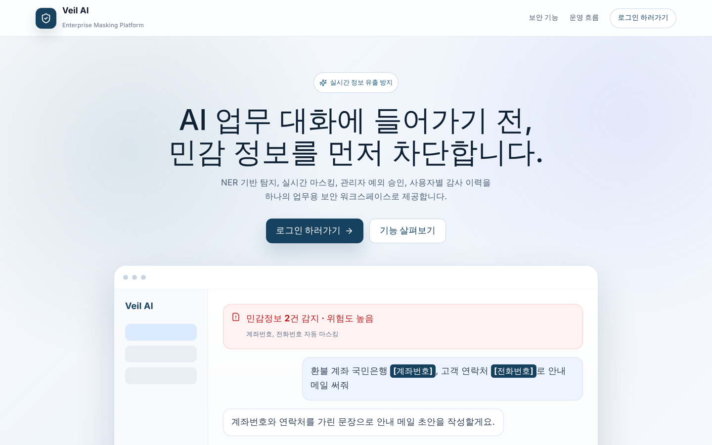
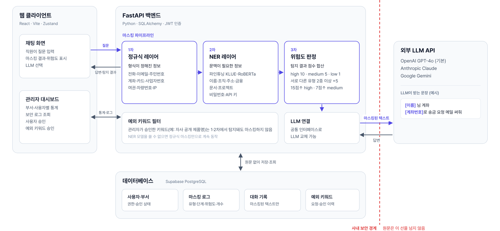
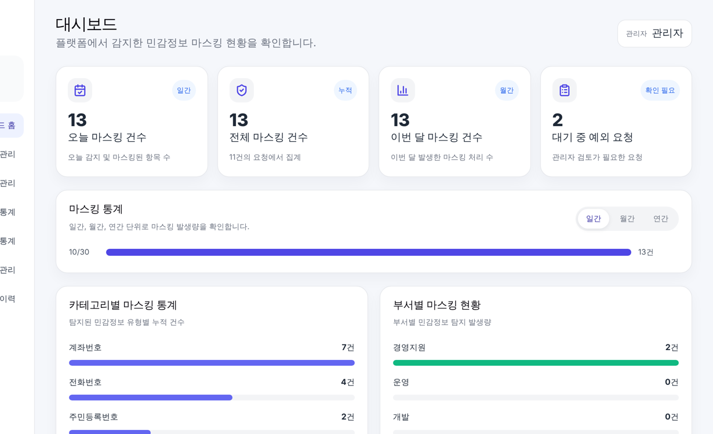

# Veil AI

**기업 정보 유출 방지 실시간 AI 마스킹 플랫폼**

직원이 생성형 AI(ChatGPT·Claude·Gemini)에 질문을 보내기 전에, 문장 속 개인정보와 사내 민감정보를 찾아 가린 뒤 마스킹된 문장만 외부 LLM으로 보냅니다.

🔗 서비스: https://veil-ai-platform.vercel.app



## 왜 만들었나

업무에 생성형 AI를 쓰면서 고객 연락처, 계좌번호, 사내 문서명 같은 정보를 프롬프트에 그대로 붙여 넣는 일이 많아졌습니다. 입력한 문장은 외부 LLM 서버로 그대로 전송되고, 회사는 무엇이 나갔는지 알 수 없습니다. Veil AI는 LLM 사용을 막는 대신, **보내기 직전에 민감정보를 걸러 주는 계층**을 둡니다.

```text
입력  환불 계좌 국민은행 123456-01-234567, 연락처 010-2345-6789로 안내 메일 써줘
전송  환불 계좌 국민은행 [계좌번호], 연락처 [전화번호]로 안내 메일 써줘
판정  계좌번호 high 10 + 전화번호 medium 5 + 유형 2종 5 = 20점 → 위험도 high
```

## 주요 기능

| 기능 | 설명 |
|---|---|
| 3단계 마스킹 | 정규식 → NER 모델 → 위험도 판정 |
| 마스킹 미리보기 | 보내기 전에 가려진 문장과 탐지 항목, 위험도 표시 |
| LLM 선택 | GPT-4o · Claude · Gemini 중 선택 |
| 관리자 대시보드 | 유형·부서·사용자별 통계, 보안 로그 |
| 예외 키워드 | 직원이 요청하고 관리자가 승인한 업무 용어는 마스킹에서 제외 |
| 원문 미저장 | DB에는 마스킹된 대화와 탐지 기록만 저장 |

## 시스템 구조



빨간 점선이 사내 경계이고, 그 선을 넘는 것은 마스킹된 텍스트뿐입니다.

| 단계 | 담당 | 탐지 대상 |
|---|---|---|
| 1차 정규식 | 형식이 정해진 정보 | 전화번호, 이메일, 주민·외국인등록번호, 여권번호, 차량번호, 계좌번호, 카드번호, 사업자등록번호, IP 등 |
| 2차 NER 모델 | 문맥을 봐야 하는 정보 | 이름, 조직, 주소, 금융정보, 문서명, 프로젝트명, 비밀번호, API 키 |
| 3차 위험도 | 탐지 결과 점수화 | high 10 · medium 5 · low 1점 합산, 서로 다른 유형 2종 이상이면 +5 → 15점 이상 high, 7점 이상 medium |

위험도는 "지금 입력한 정보가 유출되면 이만큼 위험하다"는 것을 사용자에게 바로 보여 주기 위해 함께 표시합니다.

## NER 모델

- `klue/roberta-base`를 직접 구축한 데이터셋으로 파인튜닝 (엔티티 8종, BIO 레이블 17개)
- 학습 데이터 49,576문장: 공개 KLUE-NER 문장 + 공개 데이터에 없는 라벨(문서명·프로젝트명·비밀번호)은 규칙 기반 합성
- 같은 데이터·같은 분할로 한국어 사전학습 모델 4종을 비교해 선택

| 모델 | 테스트셋 F1 |
|---|---|
| **KLUE-RoBERTa-base (적용)** | **96.14%** |
| KoELECTRA-base | 95.64% |
| KoELECTRA-NER | 95.14% |
| KcBERT-base | 89.12% |

모델 가중치는 비공개 Hugging Face 저장소에 두고, 서버가 시작할 때 내려받습니다.

## 처리 시간

배포 서버에서 실측한 마스킹 처리 시간입니다 (24건, LLM 응답 시간 제외).

| 입력 길이 | 평균 | 범위 |
|---|---|---|
| 50자 미만 | 53ms | 35 ~ 68ms |
| 50 ~ 99자 | 66ms | 52 ~ 73ms |
| 100 ~ 125자 | 78ms | 69 ~ 90ms |

평균 66ms, 모든 요청이 0.1초 이내에 처리됐습니다.

## 화면



## 기술 스택

| 구분 | 사용 기술 |
|---|---|
| Backend | Python, FastAPI, SQLAlchemy, JWT |
| AI | PyTorch, Hugging Face Transformers, KLUE-RoBERTa |
| Frontend | React, Vite, Axios |
| LLM | OpenAI GPT-4o, Anthropic Claude, Google Gemini |
| 배포 | Vercel (프론트엔드), Hugging Face Spaces Docker (백엔드), Supabase PostgreSQL (DB) |

## 폴더 구조

```text
backend/
├── app/
│   ├── main.py              서버 시작 · 라우터 등록
│   ├── api/                 auth(로그인·회원가입) · mask(미리보기·채팅·대화) · admin(통계·로그·예외 관리)
│   ├── pipeline/            regex_layer · ner_layer · risk_layer · exception_keywords
│   ├── llm/                 LLM 공통 인터페이스와 제공사별 연결
│   ├── core/                설정 · DB · 보안
│   └── schemas/             요청·응답 형식
├── models/label_info.json   학습한 모델의 레이블 정보
├── tests/                   정규식 회귀 테스트
└── tools/                   처리 시간 측정
frontend/
└── src/
    ├── pages/               랜딩·로그인 · 회원가입 · 채팅 · 프로젝트 · 관리자
    ├── components/          랜딩 마스킹 시연 · 공통 모달
    ├── features/            채팅 · 대시보드 기능
    └── api/client.js        서버 요청 · 토큰 처리
```

## 로컬 실행

```bash
# 백엔드
cd backend
python -m venv venv
source venv/bin/activate          # Windows: venv\Scripts\activate
pip install -r requirements.txt
cp .env.example .env              # API 키 입력
uvicorn app.main:app --reload     # http://localhost:8000/docs

# 프론트엔드
cd frontend
npm install
npm run dev                       # http://localhost:5173
```

NER 모델 파일이 없으면 정규식 마스킹만으로 동작합니다. 모델을 쓰려면 `.env`에 `NER_MODEL_REPO`와 `HF_TOKEN`을 넣거나 `backend/models/`에 파인튜닝한 모델 파일을 둡니다. 배포 방법은 [DEPLOYMENT.md](DEPLOYMENT.md)에 있습니다.

## 팀

캡스톤디자인 팀 프로젝트 (2026.03 ~ 2026.06, 4인)
